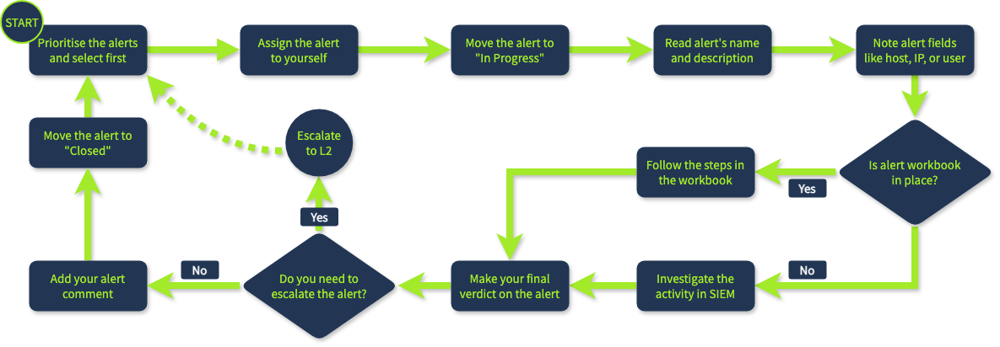

# Master Playbook: SOC L1 Alert Management & Triage Workflow

## 1. From Raw Events to SIEM Alerts

In an enterprise environment, thousands of systems (OS, firewalls, cloud infrastructure) generate millions of individual events (user logins, process executions, file downloads) daily[cite: 1]. Reviewing these manually is impossible[cite: 1].

- **The Pipeline:**
  `Raw System Event` $\rightarrow$ `Shipped via Agent/Syslog` $\rightarrow$ `Centralized SIEM/EDR` $\rightarrow$ `Detection Rule Match` $\rightarrow$ `Generated Alert`[cite: 1].
- **The Analyst Value:** Alerts save analysts from raw log review by highlighting anomalous or suspicious activities, reducing a mountain of millions of logs down to a manageable queue of daily alerts[cite: 1].

### Alert Management Platforms

| Solution Type | Examples                                          | Purpose in the SOC                                                                                    |
| :------------ | :------------------------------------------------ | :---------------------------------------------------------------------------------------------------- |
| **SIEM**      | Splunk Enterprise Security, Elastic SIEM[cite: 1] | Solid alert management and core log aggregation; the standard choice for most SOCs[cite: 1].          |
| **EDR / NDR** | Microsoft Defender, CrowdStrike[cite: 1]          | Endpoint/Network telemetry and localized alert dashboards; usually fed upstream into a SIEM[cite: 1]. |
| **SOAR**      | Splunk SOAR, Cortex SOAR[cite: 1]                 | Used by larger teams to automate response actions and centralize alerts from multiple tools[cite: 1]. |
| **ITSM**      | Jira, TheHive[cite: 1], Trello                    | Custom ticket management systems used to track investigations and incident response tasks[cite: 1].   |

---

## 2. SOC Team Roles & Responsibilities

- **SOC L1 Analysts:** The first line of defense[cite: 1]. Review the alert queue, execute triage workflows, distinguish benign noise from real attacks, and escalate true threats to L2[cite: 1].
- **SOC L2 Analysts:** Handle escalated incidents[cite: 1]. Perform deep-dive forensic investigations, coordinate containment, and drive remediation[cite: 1].
- **SOC Engineers:** Build and tune detection rules[cite: 1], ensuring alerts contain sufficient contextual fields for efficient triage[cite: 1].
- **SOC Manager:** Monitor metrics (MTTD - Mean Time to Detect, MTTR - Mean Time to Respond), track triage quality, and oversee team operations[cite: 1].

---

## 3. Anatomy of a Security Alert

Before touching an alert, an analyst must understand its key metadata properties:

1.  **Alert Time vs. Event Time:** Alert time is when the detection rule triggered (usually a few minutes after the event)[cite: 1]; Event time is when the actual action occurred on the endpoint[cite: 1].
2.  **Alert Name:** A summary description derived from the detection rule (e.g., _Unusual Login Location_, _Windows RDP Brute Force_, _Unapproved Mimikatz Usage_)[cite: 1].
3.  **Alert Severity:** Initial urgency level set by detection engineers ([🟢 Low/Info], [🟡 Medium], [🟠 High], [🔴 Critical])[cite: 1]. Analysts can adjust this if context warrants it[cite: 1].
4.  **Alert Status:** Tracks lifecycle workflow ([🆕 New/Unassigned], [🔄 In Progress], [✅ Closed/Resolved])[cite: 1].
5.  **Alert Verdict (Classification):** Final determination of the alert nature ([🔴 True Positive / Real Threat], [🟢 False Positive / Noise])[cite: 1].
6.  **Alert Assignee:** The specific analyst who has taken ownership of the alert and is responsible for its resolution[cite: 1].
7.  **Alert Description:** Detailed text explaining the rule logic, why the activity is malicious, and recommended triage steps[cite: 1].
8.  **Alert Fields / Context:** Specific technical parameters attached to the alert (Affected Hostname, User Account, Source IP, Entered Command Line)[cite: 1].

---

## 4. Alert Prioritization Logic

With hundreds of alerts in a queue, picking the right alert first is vital to prevent missing active intrusions[cite: 1]. Automated sorting logic typically follows this hierarchy[cite: 1]:

1.  **Filter the Queue:** Exclude alerts already assigned or reviewed by teammates[cite: 1].
2.  **Sort by Severity (Descending):** Start with 🔴 _Critical_ and 🟠 _High_ alerts, as they carry higher fidelity and massive impact potential, then move to _Medium_ and _Low_[cite: 1].
3.  **Sort by Time (Ascending):** Start with the **oldest** unresolved alerts[cite: 1]. _Rationale:_ An attacker from an older breach is likely already in the data-exfiltration phase, whereas a newer alert has just initiated the reconnaissance phase[cite: 1].

---

## 5. Standard Operating Procedure: The Alert Triage Lifecycle

The operational flowchart below maps out the exact step-by-step path an L1 analyst must follow during an investigation:

### Phase A: Initial Actions

- **Step 1:** Prioritize the queue and select the highest-priority alert[cite: 1].
- **Step 2:** Assign the alert to yourself to take ownership[cite: 1].
- **Step 3:** Update the alert status to **"In Progress"** to prevent duplicate work by peers[cite: 1].
- **Step 4:** Read the alert name, description, and extract key indicators (Hostnames, IPs, Usernames)[cite: 1].

### Phase B: Investigation

- **Step 5:** Check if an institutional **Workbook (Playbook/Runbook)** exists for this specific alert category[cite: 1].
  - _If Yes:_ Follow the structured workbook steps precisely[cite: 1].
  - _If No:_ Proceed with manual SIEM/EDR investigation[cite: 1].
- **Step 6:** Identify the scope of asset threat (affected user, workstation, cloud tenant, network segment)[cite: 1].
- **Step 7:** Examine surrounding telemetry—look at actions executed 15 minutes before and after the alert trigger[cite: 1].
- **Step 8:** Cross-reference indicators with Threat Intelligence platforms (VirusTotal, AlienVault OTX, AbuseIPDB)[cite: 1].

### Phase C: Verdict & Closure

- **Step 9:** Formulate the final verdict[cite: 1]. Is it malicious (**True Positive**) or benign (**False Positive**)[cite: 1]?
- **Step 10:** Determine escalation requirements[cite: 1].
  - _If True Positive requiring L2 intervention:_ Escalate the alert to an L2 analyst with your gathered context[cite: 1].
  - _If False Positive / Handled:_ Proceed to closure[cite: 1].
- **Step 11:** Document your findings by adding a comprehensive analytical comment detailing your steps and verdict reasoning[cite: 1].
- **Step 12:** Return to the dashboard and move the alert status to **"Closed"**[cite: 1].

---

## 6. Incident Reporting & Escalation Standard

Once an alert is investigated, an analyst must transition from triage to documentation and communication. Proper reporting ensures continuity, saves L2 analysts from starting investigations from scratch, and builds long-term institutional knowledge.

### The Purpose of Alert Reporting
*   **Context for Escalation:** A well-written report provides instant context for L2 analysts handling True Positives.
*   **Permanent Records:** While raw SIEM logs are purged or archived after 3–12 months due to storage limits, ticket alerts and reports are kept indefinitely.
*   **Skill Improvement:** *“If you can't explain it simply, you don't understand it well enough.”* Writing forces clarity and solidifies analytical skills.

### The Five Ws Reporting Format
Every investigation report on a True Positive or complex alert must answer the **Five Ws**:
1.  **Who:** Which user account logged in, executed a command, or downloaded the file?
2.  **What:** What exact action or sequence of events was performed?
3.  **When:** Exact timestamps of when the suspicious activity started and ended.
4.  **Where:** Which device hostname, IP address, or external website was involved?
5.  **Why:** The core reasoning behind your final verdict (True Positive vs. False Positive).

---

## 7. Escalation Matrix & L2 Hand-off

When an alert requires senior intervention, L1 analysts must follow established escalation pathways.

### Criteria for Escalation to L2
An alert must be escalated if:
1.  It is an indicator of a major cyberattack requiring deep Digital Forensics and Incident Response (DFIR).
2.  Active containment or remediation actions are required (e.g., host isolation, forced password reset, malware removal).
3.  Cross-departmental or external communication is mandatory (customers, legal, management, law enforcement).
4.  **Uncertainty/Stuck:** The L1 analyst does not fully understand the alert and requires senior guidance. *(Note: In your first months, always ask for help rather than blindly closing an alert you don't understand).*

### Escalation Protocol
1.  Reassign the alert ticket object to the active L2 analyst on shift.
2.  Attach your completed Five Ws report.
3.  Ping the L2 analyst via corporate channels (Teams, Slack, or in-person) with the direct ticket link and a brief summary.

---

## 8. SOC Crisis Communication Guidelines
When unexpected operational blockers occur during a shift, follow these standard resolutions:
*   **Unresponsive L2 during a Critical Alert:** Check emergency escalation lists. Try calling L2, escalate to L3, and finally notify the SOC Manager.
*   **Compromised Communication Channel:** If investigating a potential Slack/Teams account takeover, **do not** message the user through the compromised chat app. Use alternative channels (phone call, in-person).
*   **Alert Floods / Queue Overload:** Prioritize critically according to standard workflow logic, and immediately notify the shift L2 of the backlog volume.
*   **Post-Closure Regret (Misclassification):** If you realize a closed alert was actually a True Positive, **immediately** notify L2. Attackers often dwell silently; early notification can mitigate further impact.
*   **SIEM Log Parsing Failures:** Do not skip the alert. Investigate what data is available and escalate the broken parser/unsearchable log issue immediately to SOC engineers or L2.