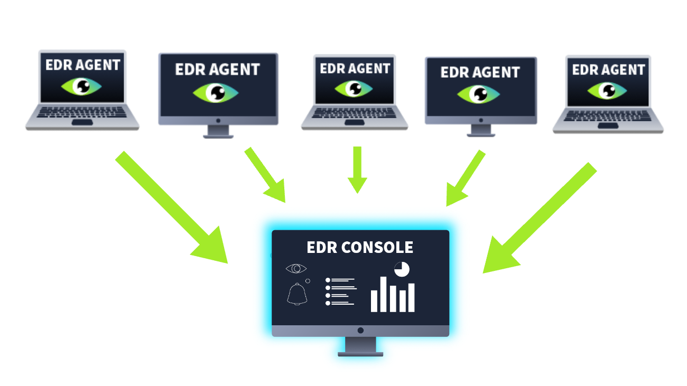
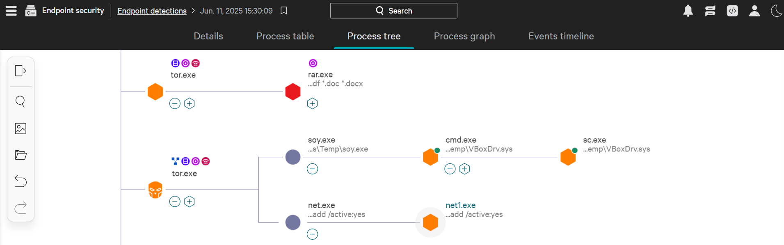
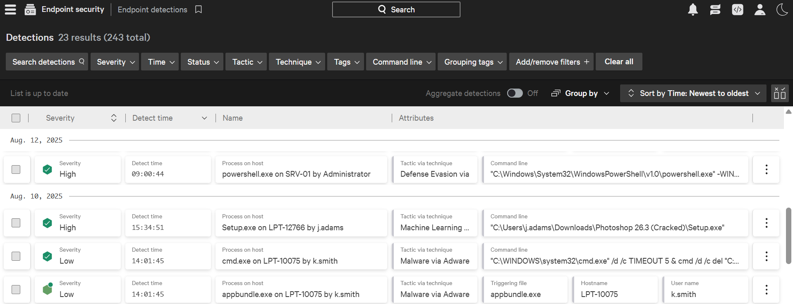
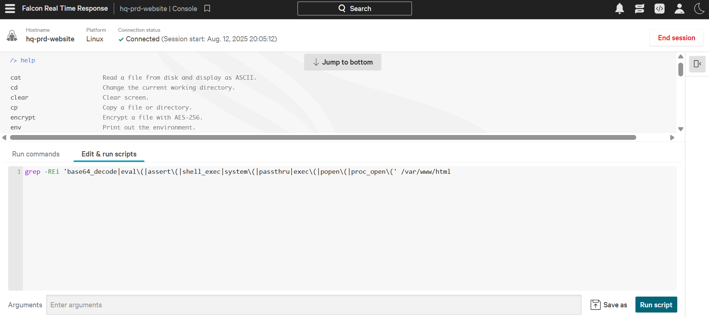

# Endpoint Detection & Response (EDR) Investigation & Containment Guide

## 1. What is an EDR & Why It Exists
**Endpoint Detection and Response (EDR)** is a host-based security solution that continuously monitors endpoint devices (laptops, workstations, servers) regardless of whether they are inside the corporate network or working remotely.

* **Common Enterprise Solutions:** CrowdStrike Falcon, Microsoft Defender for Endpoint, SentinelOne, Symantec EDR.
* **Scope Limitation:** EDR is a **host-only** visibility and response tool—it does not inspect raw perimeter network traffic across switches/routers (which requires NDR, firewalls, or IDS/IPS), though it does log network connections initiated *by processes* on the host.
* **Ecosystem Integration:** EDR agents (sensors) stream telemetry to a centralized EDR Console, which integrates with the **SIEM** so analysts can correlate endpoint events with firewall, email gateway, and identity logs.

---

## 2. EDR vs. Traditional Antivirus (AV)
Traditional AV relies primarily on static file signatures and basic heuristics, often missing fileless malware or living-off-the-land attacks. EDR acts like a flight data recorder ("black box") for the endpoint.

| Attack Stage | Traditional Antivirus (AV) | Modern EDR |
| :--- | :--- | :--- |
| **1. Phishing Doc Downloaded** | Silent if hash has no known signature | Logs file creation, source URL/origin, and hash |
| **2. User Opens `.docm`** | Ignored (`winword.exe` is trusted) | Records `winword.exe` execution and monitors child processes |
| **3. Macro Spawns PowerShell** | Missed if macro has no known signature | **Flags Alert:** Anomalous parent-child chain (`winword.exe` $\rightarrow$ `powershell.exe`) |
| **4. Obfuscated Payload Runs** | Often bypassed by encoding/obfuscation | Captures full command-line arguments and behavioral patterns |
| **5. Injection into `svchost.exe`** | Blind to in-memory process injection | Detects cross-process memory injection into legitimate system binary |
| **6. C2 Outbound Connection** | Lacks process-to-network correlation | Flags anomalous outbound connection originating from `svchost.exe` |

---

## 3. The Three Pillars of EDR

### Pillar 1: Visibility (Endpoint Telemetry)
EDR sensors collect continuous, structured telemetry from endpoints so analysts can reconstruct the full root-cause timeline:
* **Process Executions & Terminations:** Full parent-child **Process Trees**, hashes, and execution timestamps.
* **Command-Line Activity:** Exact flags and scripts executed in `cmd.exe`, `powershell.exe`, or bash.
* **Network Connections:** Destination IPs, domains, ports, and protocols tied to specific processes.
* **File & Folder Modifications:** File drops, staging directories, encryption/ransomware behavior.
* **Registry Modifications:** Persistence mechanisms (e.g., `Run` / `RunOnce` keys, services).

### Pillar 2: Detection Engines
1. **Behavioral Detection:** Flags suspicious sequences regardless of file hash (e.g., Office app spawning a shell).
2. **Anomaly Detection:** Learns endpoint baselines over time and alerts on deviations (e.g., rare auto-start registry edits).
3. **IOC Matching:** Cross-references hashes, IPs, and domains against Threat Intelligence feeds.
4. **MITRE ATT&CK Mapping:** Automatically tags alerts with Tactic and Technique IDs (e.g., *Persistence $\rightarrow$ Scheduled Task/Job*).
5. **Machine Learning (ML):** Identifies complex, multi-stage, or fileless intrusion chains across telemetry.

### Pillar 3: Response & Containment Actions
When a True Positive is confirmed, analysts execute containment directly from the central EDR console:

| Response Action | When to Use It | Operational Caution |
| :--- | :--- | :--- |
| **Host Isolation** | Active lateral movement, C2 beaconing, or ransomware risk; cuts network access except to the EDR console | High business impact—avoid isolating mission-critical production servers unless approved/necessary |
| **Terminate Process** | Stopping a specific malicious script or binary without taking the whole server offline | Killing critical OS processes (like `lsass.exe` or `svchost.exe`) can crash the host |
| **Quarantine File** | Isolating a dropped binary so it cannot execute while preserving it for analysis | Safe, reversible containment for suspicious executables |
| **Remote Shell (RTR)** | Running custom remediation scripts, inspecting live state, or removing persistence via Real-Time Response | Requires strict change control and command accuracy |
| **Artifact Collection** | Pulling **Memory Dumps, Event Logs, Registry Hives, or specific files** remotely for L2/DFIR forensics | Essential before wiping or reimaging a compromised host |

---

## 4. Reference Example: Complete EDR Incident Report (True Positive)

> **Alert Name:** `Suspicious PowerShell Execution via Microsoft Word` | **Severity:** High | **Status:** Escalated to L2 | **Verdict:** True Positive
>
> **1. Executive Summary (Who / What / When / Where):**
> On `2026-11-25 at 14:12 UTC`, EDR flagged a high-severity behavioral detection on workstation `FIN-LPT-042` (`10.24.18.77`), assigned to user `s.bennett` (Finance Department). Microsoft Word (`winword.exe`) spawned an encoded PowerShell process that attempted an outbound connection to an external uncategorized IP.
>
> **2. Technical Evidence & Process Chain:**
> * **Parent Process:** `C:\Program Files\Microsoft Office\root\Office16\WINWORD.EXE` (PID `4812`) opened `Invoice_Q4_Remittance.docm` from `C:\Users\s.bennett\Downloads\`.
> * **Child Process:** `powershell.exe` (PID `6190`) launched with `-NoP -NonI -W Hidden -Enc JABjAGwAaQBlAG4AdAA...` (decoded payload attempts `Invoke-WebRequest` to `hxxp://185.220.101[.]44/stage2.bin`).
> * **Network & Persistence Check:** Outbound connection to `185.220.101[.]44:443` was blocked/flagged; no scheduled tasks or `Run` key persistence modifications were observed post-execution.
> * **MITRE ATT&CK Mapping:** Execution (`T1059.001` — PowerShell), Initial Access (`T1566.001` — Spearphishing Attachment).
>
> **3. Analytical Reasoning:**
> `winword.exe` spawning a hidden, Base64-encoded PowerShell command attempting to fetch a remote binary from a suspicious external IP confirms a malicious macro execution (**True Positive**), not normal user or admin behavior.
>
> **4. Containment & Escalation Actions:**
> * Isolated host `FIN-LPT-042` via EDR console to prevent secondary payload execution or lateral movement.
> * Quarantined `Invoice_Q4_Remittance.docm`.
> * Escalated ticket to L2 Incident Response to sweep email gateway logs for other recipients of `Invoice_Q4_Remittance.docm`, block `185.220.101[.]44` at the perimeter firewall, and reset `s.bennett`'s session tokens.