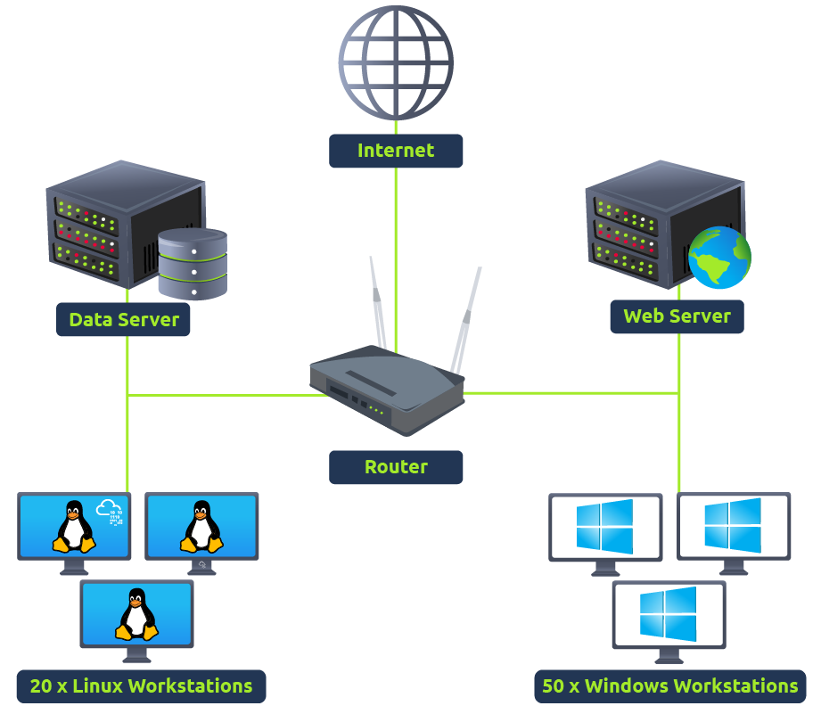
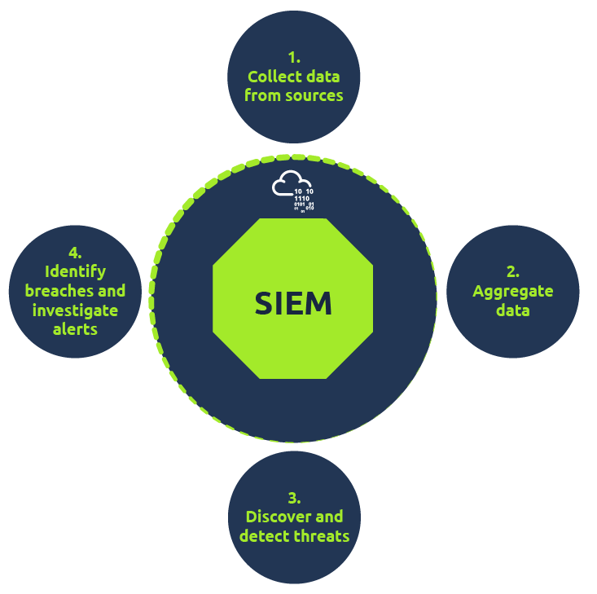
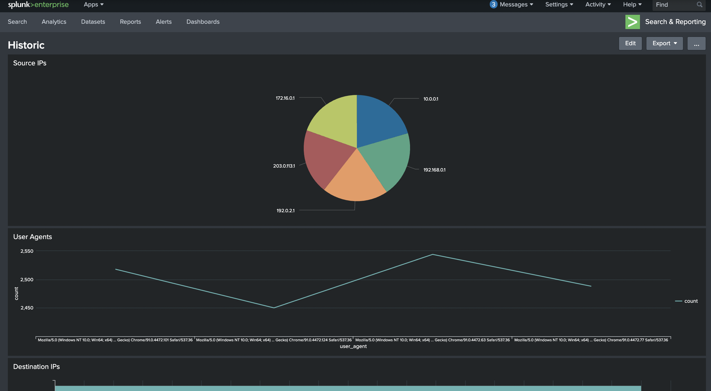
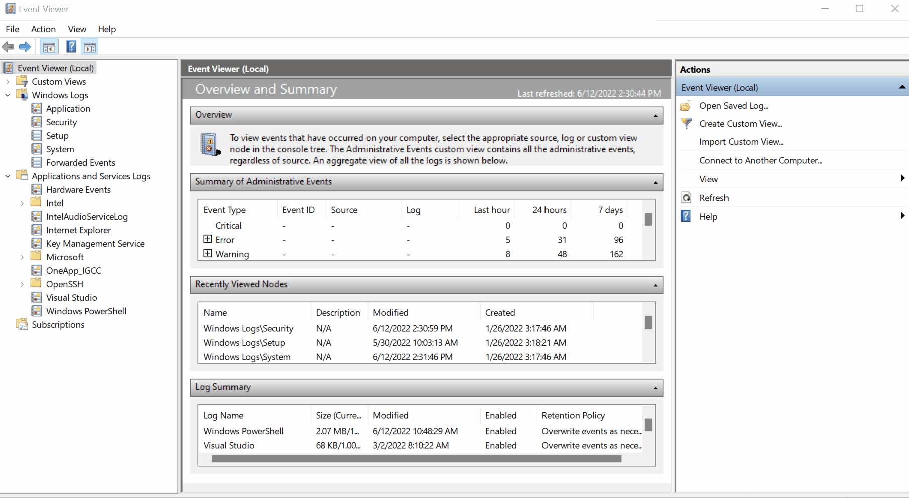
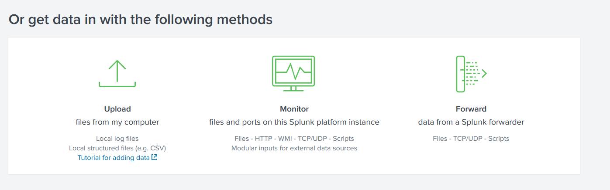

# Security Information & Event Management (SIEM) Fundamentals Guide

## 1. Why SIEM Exists: The Log Challenge
Enterprise networks contain workstations, servers, web servers, firewalls, routers, and security appliances that continuously generate logs.

### Two Main Categories of Log Sources
* **Host-Centric Log Sources:** Events occurring on or within a host (Windows, Linux, servers), such as user authentication attempts, file access, process creation, registry edits, and PowerShell executions.
* **Network-Centric Log Sources:** Events generated as traffic moves across the network or to/from the internet (firewalls, IDS/IPS, routers), such as SSH connections, FTP transfers, web traffic, VPN sessions, and network file sharing.

### Problems Without a SIEM
* **Numerous Log Sources:** Hundreds of events per second across many systems make manual review impractical and cause analysts to miss key activity.
* **No Centralization:** Connecting via SSH, RDP, or local consoles to check individual machines wastes critical investigation time.
* **Limited Context:** Isolated events can look benign on their own until correlated across sources—for example, a normal file access happening right after an account accesses a host via lateral movement from another compromised machine.
* **Limited Analysis:** High log volume overwhelms human-only review.
* **Format Issues:** Different operating systems and appliances output logs in inconsistent formats and structures.

---

## 2. Core Features of a SIEM

* **Centralized Log Collection:** Aggregates logs from endpoints, servers, and network devices into one platform via lightweight agents/forwarders, APIs, or network protocols.
* **Parsing & Normalization:** **Parsing** breaks raw log text into structured fields/key-value pairs, while **Normalization** maps different source formats into a consistent schema so analysts can query across sources cleanly.
* **Log Correlation:** Links multiple related events across time and log sources to spot attack patterns—such as an unfamiliar VPN IP login, shared-drive document access, PowerShell execution, and an outbound connection within a five-minute window signaling possible data exfiltration from compromised credentials.
* **Real-Time Alerting:** Evaluates incoming and correlated events against detection rules and triggers alerts when rule conditions match.
* **Dashboards & Reporting:** Summarizes telemetry and alert activity into visual panels (alert highlights, system/health notifications, failed logons, ingested event counts, triggered rules, top domains) for rapid monitoring and reporting.

---

## 3. Common Log Sources & Ingestion Methods

### Common Log Sources & Examples
* **Windows Machines:** Recorded in **Event Viewer** with numeric **Event IDs** identifying each activity type and forwarded to the SIEM.

* **Linux Systems:** Store system, service, and security logs in `/var/log/` paths such as `/var/log/auth.log` or `/var/log/secure` (authentication), `/var/log/cron` (scheduled jobs), `/var/log/kern` (kernel events), and `/var/log/httpd` or `/var/log/apache` (web server logs).
  * *Sample Cron Log:* `May 28 13:04:20 ebr crond[2843]: ... (user root job sys-hourly)`
* **Web Servers:** Capture incoming and outgoing HTTP/HTTPS requests and responses (such as Apache access logs showing source IP, timestamp, HTTP method/URI/status code, and user agent) to help spot web attacks.

### How Logs Are Ingested

* **Agent / Forwarder:** A lightweight endpoint agent (such as a Splunk forwarder) collects host logs and streams them to the SIEM.
* **Syslog:** A standard logging protocol used to ship real-time events from network gear, web servers, databases, and systems to a central collector.
* **Manual Upload:** Offline ingestion of log files into platforms like Splunk or ELK for ad-hoc parsing and analysis.
* **Port-Forwarding:** Configuring the SIEM to listen on specific network ports to receive forwarded log streams.

---

## 4. Detection Rules & Alert Investigation Workflow

### How Detection Rules Work
Detection rules are logical conditions evaluated against parsed field-value pairs in normalized logs.
* **Multiple Failed Logins:** Trigger an alert if a user has 5 failed login attempts within 10 seconds.
* **Successful Login After Failures:** Trigger an alert when a valid login follows repeated failed authentication attempts.
* **Restricted USB Usage:** Alert when a USB device is connected on a host where policy prohibits removable media.
* **Outbound Data Volume:** Alert when outbound traffic exceeds a policy threshold (such as > 25 MB) for potential data exfiltration.
* **Event Log Cleared (Example):** `LogSource == "WinEventLog"` AND `EventID == 104` (or `1102` in Security log) to catch adversaries clearing tracks.
* **Suspicious `whoami` Execution (Example):** `LogSource == "WinEventLog"` AND `EventCode == 4688` AND `NewProcessName` contains `whoami` to spot post-exploitation reconnaissance.

### Post-Alert Actions
* **False Positive:** Close as benign/expected activity and consider tuning the detection rule (e.g., excluding known administrative or maintenance noise) to reduce repeat false alarms.
* **True Positive:** Continue investigation, contact asset/account owners when appropriate, isolate affected hosts, block malicious IPs/indicators, and escalate to L2 when deeper response or remediation is needed.