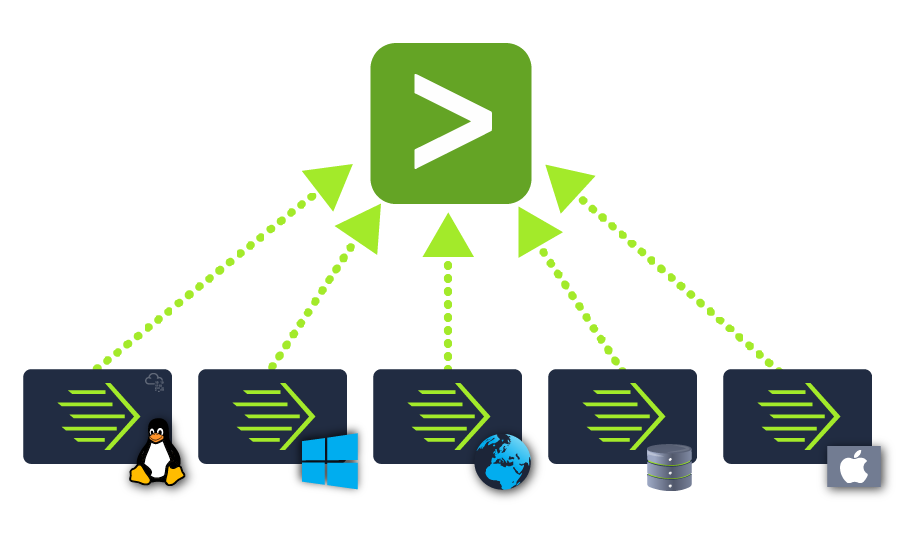
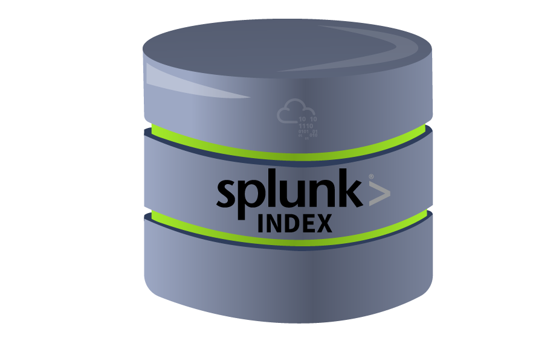
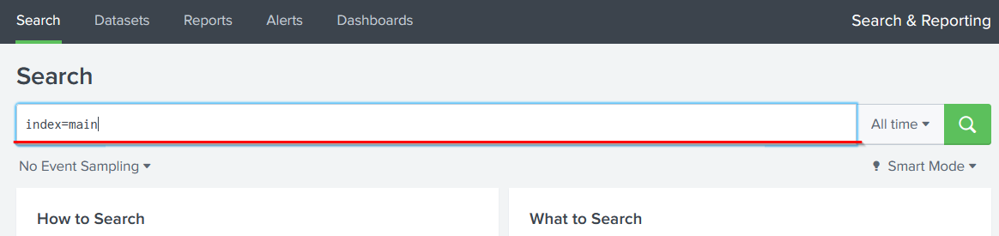
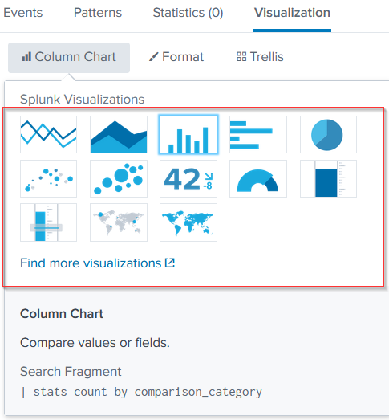
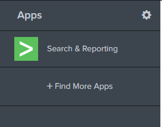
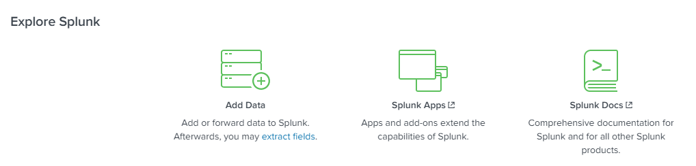
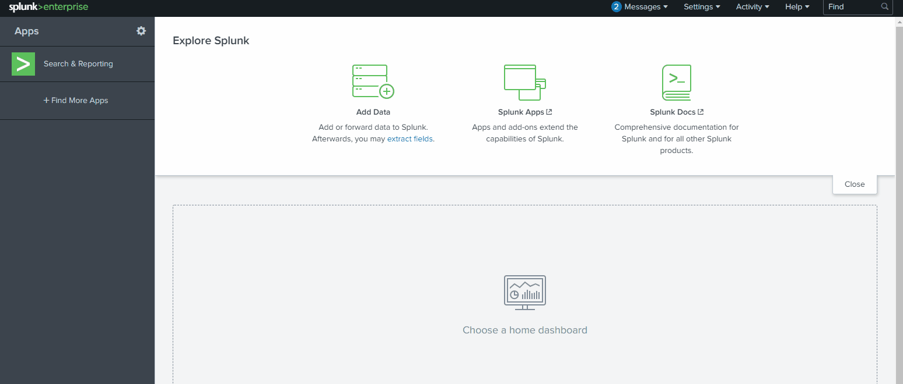
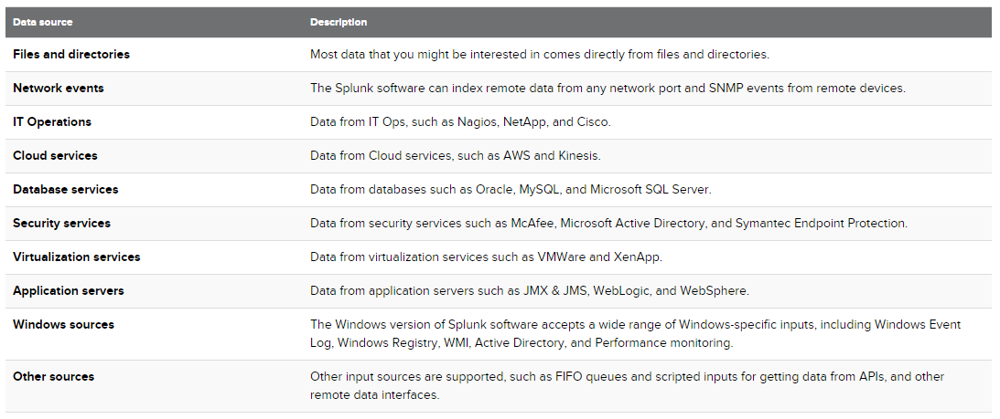

# Splunk Architecture, Navigation & Data Ingestion Guide

## 1. Core Splunk Components
Splunk relies on three primary components working together to collect, process, store, and search log data:

### 1) Splunk Forwarder
A lightweight agent installed on monitored endpoints to collect logs and forward them to Splunk with minimal performance overhead on the host.
* **Common Data Sources:** Web servers (web traffic), Windows hosts (Event Logs, PowerShell, Sysmon), Linux hosts (host-centric logs), and databases (connection requests, responses, errors).



### 2) Splunk Indexer
Processes data received from forwarders by parsing and normalizing it into field-value pairs, categorizing it, and storing results as searchable events.



### 3) Search Head
The interface within the **Search & Reporting** app where analysts query indexed events using **SPL (Search Processing Language)** and build tables and charts (pie, bar, column). When a search runs, the request goes to the indexer and returns matching events as field-value pairs.





---

## 2. Navigating the Splunk Interface

* **Splunk Bar (Top Panel):** Quick access to Messages, Settings, Activity (search job/process progress), Help, Find, and switching between installed apps.


* **Apps Panel:** Displays installed Splunk apps—defaulting to **Search & Reporting**—and allows switching apps (also accessible from the Splunk Bar).



* **Explore Splunk:** Shortcut links to add data, install new Splunk apps, and open Splunk documentation.



* **Home Dashboard:** Displays selected or custom dashboards (including a **Yours** tab for dashboards you create) from the dropdown menu or dashboards listing page.



---

## 3. Data Source Categories & Ingestion Workflow

### Splunk Data Source Categories


* **Files and directories:** Logs read directly from files and directories.
* **Network events:** Remote network port data and SNMP events from network devices.
* **IT Operations:** Telemetry from IT ops tools (e.g., Nagios, NetApp, Cisco).
* **Cloud services:** Logs from cloud platforms and streams (e.g., AWS, Kinesis).
* **Database services:** Connection, response, and error logs from databases (e.g., Oracle, MySQL, SQL Server).
* **Security services:** Events from security tools and directory services (e.g., McAfee, Active Directory, Symantec Endpoint Protection).
* **Virtualization services:** Data from virtualization platforms (e.g., VMware, XenApp).
* **Application servers:** Logs from app servers (e.g., JMX/JMS, WebLogic, WebSphere).
* **Windows sources:** Windows Event Logs, Registry, WMI, Active Directory, and performance counters.
* **Other sources:** FIFO queues, scripted inputs (e.g., APIs), and other custom interfaces.

### Five-Step Upload Wizard
When uploading local files via **Add Data → Upload**:
1. **Select Source:** Choose the log file and data source.
2. **Select Source Type:** Confirm or set the format (e.g., JSON, syslog).
3. **Input Settings:** Choose or create the target **index** and associated host metadata.
4. **Review:** Verify settings before ingestion.
5. **Done:** Complete ingestion so events are indexed and searchable.

---

## 4. Practical Lab Notes: Ingesting & Querying VPN Logs (`VPN_Logs`)
When importing newline-delimited JSON (`VPN_logs`) into index `VPN_Logs` and searching across **All time** in **Search & Reporting**:
* Adding `| spath` after the base search extracts nested/JSON fields so you can filter and aggregate on fields like `UserName`, `Source_ip`, and `Source_Country`.

### Core Verification & Investigation Queries
```spl
# Total events in the VPN_Logs index
index=VPN_Logs
| stats count

# Count events for user Maleena
index=VPN_Logs
| spath
| search UserName="Maleena"
| stats count

# Find usernames and event counts for a specific source IP
index=VPN_Logs
| spath
| search Source_ip="107.14.182.38"
| stats values(UserName) as UserName count

# Count events originating outside France
index=VPN_Logs
| spath
| search Source_Country!="France"
| stats count

# Count VPN events for a specific source IP
index=VPN_Logs
| spath
| search Source_ip="107.3.206.58"
| stats count